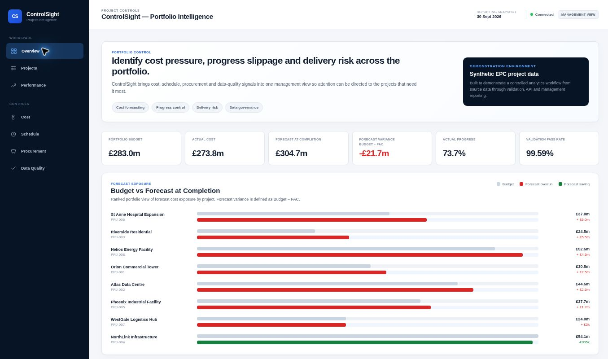
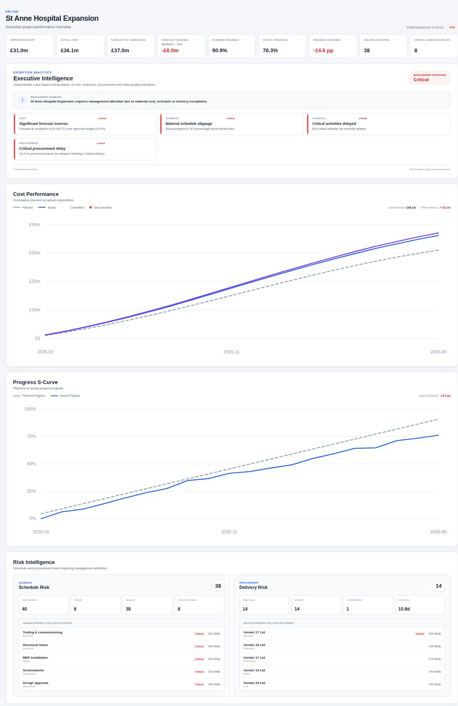
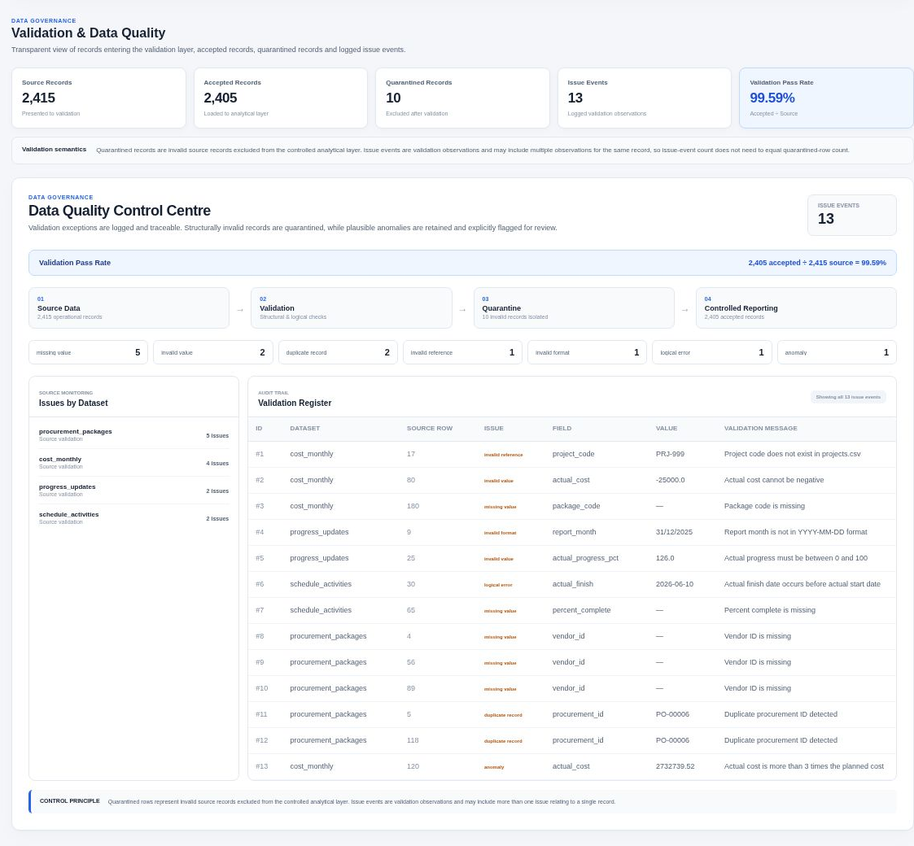

```markdown
# ControlSight

### Project Controls Intelligence Platform

ControlSight is an end-to-end project controls analytics application that transforms synthetic EPC-style cost, progress, schedule, procurement and data-quality records into management-ready intelligence.

It combines a **Python ETL and validation pipeline, SQLite analytical model, FastAPI backend and native HTML/CSS/JavaScript dashboard** to demonstrate how project controls can be delivered through a custom API-driven web application rather than a conventional BI report.

**Live Demo:** https://controlsight.onrender.com

> All project, vendor, financial and operational data used in ControlSight is synthetic and fictional. No confidential company information is used.

---
## Live Dashboard Preview

### Portfolio Overview



### Project Detail



### Data Quality Control Centre



---

## Overview

ControlSight was built to demonstrate the full analytical workflow from raw project-control data to management decision support.

```text
Synthetic Project Data
        ↓
Python ETL
        ↓
Validation & Quarantine
        ↓
Controlled SQLite Model
        ↓
FastAPI Analytics Layer
        ↓
Rules-Based Management Logic
        ↓
HTML / CSS / JavaScript Dashboard
        ↓
Management Decision Support
```

The platform supports both portfolio-level monitoring and project-level drill-down across:

- cost performance
- progress performance
- schedule risk
- procurement risk
- data quality
- management attention

The objective was not simply to build a visual dashboard, but to create a small end-to-end analytical system where calculations, controls, data-quality logic and reporting can be traced through the architecture.

---

## Business Problem

Large engineering and construction projects generate information across multiple operational areas, including:

- approved budgets
- actual costs
- commitments
- forecasts
- planned and actual progress
- schedule activities
- procurement packages
- vendor performance
- data-quality exceptions

The challenge is therefore not just visualisation.

A useful project-controls solution must also:

1. validate incoming data;
2. isolate structurally invalid records;
3. preserve suspicious but plausible observations for investigation;
4. create consistent reporting structures;
5. calculate reliable KPIs;
6. identify emerging project risks;
7. prioritise projects requiring management attention; and
8. present the results through a clear management interface.

ControlSight demonstrates this process from end to end.

---

## Core Capabilities

### Portfolio Overview

The executive portfolio view provides consolidated indicators including:

- total approved budget
- actual cost to date
- committed cost
- forecast at completion
- forecast variance
- planned portfolio progress
- actual portfolio progress
- progress variance
- validation pass rate

Portfolio progress is budget-weighted so that larger projects contribute proportionally to the overall portfolio result.

---

### Project Portfolio

The project portfolio provides project-level comparison across:

- approved budget
- actual cost
- forecast at completion
- forecast variance
- actual progress
- progress variance
- performance status

Projects can be searched and filtered using Green, Amber and Red performance status.

Performance status represents the headline cost and progress position of each project.

---

### Management Attention Index

ControlSight includes a transparent rules-based **Management Attention Index**.

The score is designed to prioritise projects requiring management review across five control dimensions:

| Dimension | Maximum Score |
|---|---:|
| Cost | 30 |
| Progress | 25 |
| Critical Schedule | 25 |
| Procurement | 15 |
| Data Quality | 5 |
| **Total** | **100** |

The score is a **management prioritisation mechanism**, not a statistical probability of project failure.

This separates two related but distinct concepts:

**Performance Status**  
Headline cost and progress position.

**Management Attention**  
Broader exception severity incorporating cost, progress, critical schedule delays, procurement exposure and data-quality issues.

Small cost and progress movements use a deadband so immaterial deviations do not automatically increase the attention score.

---

## Project-Level Intelligence

Selecting a project opens a detailed project-controls view containing:

- approved budget
- actual cost
- committed cost
- forecast at completion
- forecast variance
- planned progress
- actual progress
- progress variance
- delayed activities
- critical schedule delays
- procurement exposure
- automated management insights
- cumulative cost trend
- progress S-curve
- schedule-risk detail
- procurement-risk detail

This allows users to move from portfolio-level prioritisation into the underlying project-control drivers.

---

## Cost Control Methodology

Cost reporting distinguishes between **period movements** and **forecast snapshots**.

Actual and planned costs are treated as period flows and accumulated through time.

Forecast at Completion is treated as a reporting-date snapshot rather than summed across historical periods.

Forecast variance is defined as:

```text
Forecast Variance = Approved Budget - Forecast at Completion
```

Therefore:

- a negative value indicates forecast overrun
- a positive value indicates forecast saving

ControlSight also applies a forecast control layer so that, within the synthetic model:

```text
Final FAC = max(
    Source FAC,
    Cumulative Actual Cost,
    Cumulative Committed Cost
)
```

This prevents a reporting snapshot from showing forecast completion cost below incurred or committed expenditure.

The source forecast remains the primary FAC where it is already valid.

The application deliberately does not estimate FAC from physical progress because that would require a formal earned-value methodology.

---

## Progress Methodology

Progress performance compares planned and actual completion over time.

Progress variance is calculated as:

```text
Progress Variance =
Actual Progress - Planned Progress
```

Because this is the difference between two percentages, the result is reported in **percentage points (pp)**.

Example:

```text
Planned Progress = 79.2%
Actual Progress  = 72.0%

Progress Variance = -7.2 pp
```

A negative value indicates progress behind plan.

---

## Portfolio Progress

Portfolio progress is weighted using approved project budget:

```text
                     Σ(Project Progress × Approved Budget)
Portfolio Progress = ─────────────────────────────────────
                              Σ Approved Budget
```

This prevents small and large projects from contributing equally to the overall portfolio measure.

Current synthetic portfolio values are:

```text
Weighted Planned Progress: 78.33%
Weighted Actual Progress:  73.71%
Progress Variance:         -4.62 pp
```

---

## Schedule Risk

Schedule analytics identify:

- total activities
- critical activities
- delayed activities
- critical delayed activities
- activity completion
- delay duration

Critical-path delays are surfaced separately because they can represent a materially different management risk from non-critical delays.

---

## Procurement Risk

Procurement analytics monitor:

- procurement packages
- delayed deliveries
- critical delivery delays
- average delivery delay
- delayed package value
- vendor information

This allows procurement exposure to be considered alongside cost, progress and schedule performance.

---

## Data Quality & Governance

ControlSight treats data quality as part of project controls rather than silently cleaning problematic records.

The validation workflow is:

```text
Source Data
    ↓
Validation
    ↓
Quarantine / Exception Handling
    ↓
Controlled Analytical Reporting
```

Structurally invalid records are excluded from the analytical reporting layer.

Plausible but suspicious observations may instead be retained and explicitly flagged for investigation.

The principle is:

> **Invalid records are isolated. Suspicious but plausible records are retained, flagged and investigated.**

This preserves auditability while preventing known invalid records from contaminating management reporting.

---

## Validation Transparency

The dashboard exposes the validation denominator directly.

Current synthetic dataset:

```text
Source Records:       2,415
Accepted Records:     2,405
Quarantined Records:     10
Issue Events:            13
Validation Pass Rate: 99.59%
```

Validation pass rate is calculated as:

```text
                       Accepted Analytical Records
Validation Pass Rate = ─────────────────────────── × 100
                         Source Records Evaluated
```

For the current dataset:

```text
2,405 ÷ 2,415 × 100 = 99.59%
```

Issue events are reported separately because one source row can generate more than one validation observation.

Therefore:

```text
Issue Events ≠ Quarantined Rows
```

This distinction prevents logged issues from being incorrectly treated as rejected-record counts.

---

## Data Quality Control Centre

The dashboard includes a dedicated data-quality view containing:

- source-record totals
- accepted-record totals
- quarantined-record totals
- validation pass rate
- issue-event totals
- validation register
- source row references
- affected fields
- source values
- validation messages

Example issue types include:

- missing values
- invalid values
- duplicate records
- invalid references
- invalid formats
- logical errors
- statistical or business-rule anomalies

All logged validation events remain visible in the register.

---

## Anomaly Handling

ControlSight does not automatically delete every unusual observation.

For example, a cost observation that is structurally valid but materially exceeds its planned value can remain in the analytical dataset while receiving an anomaly flag.

This allows management reporting to expose the issue rather than hiding it.

The project intentionally retains one cost anomaly to demonstrate this behaviour.

---

## Automated Management Insights

Project-level management insights are generated using deterministic project-control rules.

The logic evaluates indicators such as:

- forecast cost overrun
- progress slippage
- critical schedule delays
- procurement delays
- data-quality anomalies

The feature is intentionally described as **rules-based exception analytics**, not artificial intelligence.

This keeps the methodology explainable and auditable.

---

## Architecture

```text
┌──────────────────────────────┐
│ Synthetic EPC-Style Data     │
│ Cost / Progress / Schedule   │
│ Procurement / Vendors        │
└───────────────┬──────────────┘
                │
                ▼
┌──────────────────────────────┐
│ Python ETL & Validation      │
│ Cleaning / Rules / Audit     │
│ Quarantine / Issue Logging   │
└───────────────┬──────────────┘
                │
                ▼
┌──────────────────────────────┐
│ SQLite Analytical Layer      │
│ Controlled Reporting Tables  │
│ Derived Metrics              │
└───────────────┬──────────────┘
                │
                ▼
┌──────────────────────────────┐
│ FastAPI Backend              │
│ REST Endpoints               │
│ Business Logic               │
│ Attention Scoring            │
└───────────────┬──────────────┘
                │
                ▼
┌──────────────────────────────┐
│ Native Web Frontend          │
│ HTML / CSS / JavaScript      │
│ SVG Visualisations           │
└───────────────┬──────────────┘
                │
                ▼
┌──────────────────────────────┐
│ Management Intelligence      │
│ Portfolio → Project Drilldown│
└──────────────────────────────┘
```

The architecture separates source data, transformation logic, analytical storage, API delivery and presentation.

This allows business logic to remain independent from the user interface.

---

## Technology Stack

### Data & Analytics

- Python
- pandas
- SQL
- SQLite
- Jupyter

### Backend

- FastAPI
- Python
- REST API architecture

### Frontend

- HTML5
- CSS3
- JavaScript
- Native SVG visualisations

### Engineering & QA

- Git
- deterministic data validation
- analytical regression checks
- data-quality exception logging
- relational analytical modelling
- cloud deployment with Render

---

## API Layer

The FastAPI backend exposes analytical information to the frontend through REST endpoints.

Key endpoints include:

```text
/api/kpis
/api/projects
/api/data-quality
/api/cost-anomalies

/api/projects/{project_code}/overview
/api/projects/{project_code}/cost-trend
/api/projects/{project_code}/progress-trend
/api/projects/{project_code}/schedule-risk
/api/projects/{project_code}/procurement-risk
/api/projects/{project_code}/management-insights

/api/portfolio/attention-ranking
```

Interactive FastAPI documentation is also available when the application is running.

---

## Quality Assurance

ControlSight includes analytical QA and regression checks designed to reconcile reporting outputs against underlying data.

The QA process checks areas including:

- portfolio budget reconciliation
- actual-cost reconciliation
- committed-cost reconciliation
- FAC reconciliation
- forecast variance
- project-level KPIs
- weighted portfolio progress
- validation pass rate
- schedule indicators
- procurement indicators
- retained anomaly detection

A deliberately retained cost anomaly is treated as a warning rather than silently removed.

---

## Repository Structure

```text
ControlSight/
│
├── data/
│   ├── raw/
│   ├── processed/
│   └── database/
│
├── docs/
│   └── data_dictionary.md
│
├── src/
│   │
│   ├── analytics/
│   │   ├── metrics.ipynb
│   │   └── qa_checks.py
│   │
│   ├── backend/
│   │   ├── build_database.py
│   │   └── main.py
│   │
│   ├── data_generation/
│   │   └── generate_raw_data.ipynb
│   │
│   ├── etl/
│   │   └── clean_data.ipynb
│   │
│   └── frontend/
│       ├── index.html
│       ├── css/
│       │   ├── styles.css
│       │   └── polish.css
│       └── js/
│           ├── dashboard.js
│           └── polish.js
│
├── .gitignore
├── README.md
├── render.yaml
└── requirements.txt
```

---

## Running ControlSight Locally

Clone the repository and move into the project directory.

Install dependencies:

```bash
pip install -r requirements.txt
```

Build the analytical database:

```bash
python src/backend/build_database.py \
  --output data/database/controlsight.db
```

Start the FastAPI server:

```bash
python -m uvicorn src.backend.main:app --reload
```

Open the dashboard:

```text
http://127.0.0.1:8000
```

Interactive API documentation:

```text
http://127.0.0.1:8000/docs
```

---

## Deployment

ControlSight is deployed using Render.

The production deployment rebuilds the analytical database during the build stage and then launches the FastAPI application using Uvicorn.

**Live Application**

https://controlsight.onrender.com

The free hosting instance may take a short time to start after a period of inactivity.

---

## Why a Custom Web Dashboard?

ControlSight is not intended to demonstrate that HTML dashboards are universally better than traditional BI platforms.

Instead, it demonstrates where a custom analytics application can provide additional flexibility.

A native web application can support:

- custom user experience
- API-driven integration
- bespoke project-control workflows
- transparent business rules
- custom drill-down behaviour
- application-level validation
- tailored management prioritisation
- integration with operational systems
- complete control over analytical delivery

Traditional BI platforms remain highly appropriate for many reporting requirements.

ControlSight demonstrates the additional flexibility available when analytics are delivered as an application rather than only as a report.

---

## Project Objective

ControlSight was developed as a portfolio project to demonstrate the ability to connect:

**project controls + business understanding + data engineering + analytics + backend development + frontend delivery**

The goal was to create a small but complete analytical system in which:

```text
Source Data
     ↓
Validation
     ↓
Transformation
     ↓
Analytical Model
     ↓
Business Logic
     ↓
API
     ↓
Management Interface
     ↓
Decision Support
```

can be traced from end to end.

---

## Disclaimer

All project names, financial values, schedules, procurement records, vendors and operational observations used in ControlSight are **synthetic and fictional**.

The dataset was created solely for software, analytics and portfolio demonstration purposes.
```